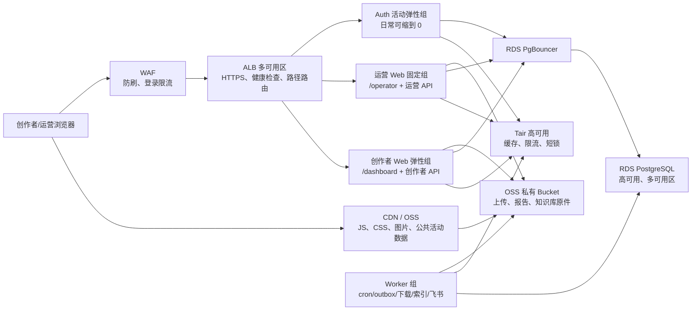

# 2 万创作者规模成本优化升级方案

> 状态：设计稿  
> 日期：2026-08-17  
> 适用范围：当前约 1.5 万主播、一年内约 2 万主播，理想状态约 2 万注册创作者；假设日常 3,000 创作者在线、活动发布时最高 2 万创作者集中刷新/登录/报名/投稿；运营端同时在线低于 100，每月新增约 20 万条短视频稿件。

## 1. 结论

当前“单个 Next.js 进程 + 进程内 Worker + Prisma 直连 PostgreSQL + 本地文件”的部署形态不能满足目标。升级不能只提高 ECS 配置，必须完成以下结构性改造：

1. 创作者 Web、运营 Web 与定时任务/下载器/索引器/飞书长连接彻底分离；创作者池横向扩容，运营池保持小规格高可用。
2. 公共活动数据、静态资源和活动封面由 Tair、OSS、CDN 吸收热点流量。
3. 个性化页面减少数据库往返，ALB 按路径把创作者端与运营端路由到不同的无状态实例组。
4. 登录流量独立隔离和限流；报名、投稿增加幂等键和过载保护。
5. RDS 启用高可用与 PgBouncer，控制每个 Web 进程的连接预算。
6. 以 2,000 动态 RPS、250 报名 TPS、活动期 2 万虚拟用户作为验收目标进行压测，而不是用注册人数推测容量。

方案允许 2 万用户在活动开始后数分钟内集中进入。若 2 万请求真的在同一秒到达，系统应通过边缘限流、排队和客户端退避在 15–30 秒内消化，而不是承诺 2 万请求全部在 1 秒内完成。

## 2. 容量口径和服务目标

### 2.1 设计负载

| 场景 | 目标负载 | 说明 |
| --- | ---: | --- |
| 注册创作者 | 20,000 | 理想上限，不等于并发 |
| 工会主播 | 当前 15,000，预计 20,000 | AnchorStat 量级较小；直播日明细按最坏 730 万行/年规划 |
| 日常在线 | 3,000 VU / 150–300 RPS | 平均每个活跃用户约 10–20 秒一次请求 |
| 活动高峰读取 | 20,000 VU / 2,000 RPS | 持续 15 分钟，另承受 4,000 RPS 的 60 秒边缘突发 |
| 集中登录 | 20,000 次 / 5 分钟 | 平均 67 TPS；额外测试 300 TPS、持续 60 秒 |
| 集中报名 | 10,000 次 / 2 分钟 | 平均 83 TPS；额外测试 250 TPS 突发 |
| 集中投稿 | 5,000 次 / 5 分钟 | 平均 17 TPS；额外测试 50 TPS 突发 |
| 运营端并发 | < 100 VU | 独立小规格实例组，不跟随创作者流量扩容 |
| 稿件数据增长 | 200,000 条/月 | 约 240 万条/年，按至少三年约 720 万行规划索引与归档 |

容量换算采用：

```text
RPS ≈ 活跃用户数 ÷ 平均请求间隔（秒）
带宽 ≈ RPS × 压缩后响应字节数 × 8
数据库负载 ≈ RPS × 每请求数据库往返数 × 缓存未命中率
```

例如 2,000 RPS、每个动态响应压缩后 10 KB，源站出带宽约为 160 Mbps。因此仍需把 JS/CSS/图片和公共活动数据放到 CDN，并把个性化响应控制在 5–10 KB。

### 2.2 上线验收 SLO

| 指标 | 日常 | 活动峰值 |
| --- | ---: | ---: |
| 活动列表/详情 GET p95 | ≤ 500 ms | ≤ 800 ms |
| 活动列表/详情 GET p99 | ≤ 1 s | ≤ 2 s |
| 登录 p95 / p99 | ≤ 1 s / 2 s | ≤ 1.5 s / 3 s |
| 报名、投稿 p95 / p99 | ≤ 800 ms / 1.5 s | ≤ 1 s / 2 s |
| 非限流请求错误率 | < 0.1% | < 0.5% |
| 热点公共数据缓存命中率 | ≥ 95% | ≥ 98% |
| RDS 连接使用率 | < 60% | < 75% |
| 重复报名/重复投稿 | 0 | 0 |

峰值期间允许对超过容量的请求返回 `429 + Retry-After`，前端必须自动指数退避并加入随机抖动。主动限流不计入系统错误率，但其比例必须单独展示和告警。

## 3. 当前阻塞点

### 3.1 无法横向扩容

`instrumentation.ts` 会随每个 Next.js 进程启动 cron、日志清理、日报、舆情下载器、知识库索引器和飞书长连接。当前部署文档因此强制 PM2 单实例。直接改成 cluster 或启动多台 ECS 会造成定时任务重复、文件状态不一致和飞书重复连接。

### 3.2 创作者请求查询放大

创作者布局和具体页面分别调用 `requireCreator()`。概览页还会执行多次状态 count、列表、激励查询和活动查询；一次概览渲染约有 13 次 SELECT，部分情况下还会追加活动名查询。

目标是：热点页面缓存命中时数据库往返不超过 2 次，未命中不超过 4 次。

### 3.3 读取路径产生数据库写入

`autoTransitionActivities()` 在创作者概览、活动列表、活动详情和报名/投稿前执行两次 `updateMany`。高峰刷新会把纯读取流量变成大量重复 UPDATE。

### 3.4 热点数据没有缓存

活动目录、活动详情、AI 配置和 BI 聚合每次实时查询数据库。BI 一次执行约 10 组聚合查询，并明确设置为 `force-dynamic`。

### 3.5 列表无上限及索引不完整

创作者活动列表和投稿列表没有分页；高频查询缺少 `status + createdAt`、`creatorId + status + createdAt`、`status + endAt` 等组合索引。

### 3.6 登录和投稿路径存在峰值放大器

- 登录使用 Argon2，安全性正确，但集中登录会产生明显 CPU 峰值。目前没有分布式登录限流。
- 投稿遇到抖音短链时会在请求内同步跟随外部重定向，最长等待 5 秒。第三方网络抖动会耗尽应用并发槽。
- 活动封面和报告文件仍存 ECS 本地磁盘，阻碍多实例共享和弹性缩容。

## 4. 目标架构



### 4.1 流量分层

1. **CDN 层**：`/_next/static/*`、活动封面、灵感素材、公开活动目录/详情缓存。
2. **创作者 Web 层**：承载 `/dashboard*`、活动浏览、个人状态、报名和投稿，按活动流量弹性扩容。
3. **运营 Web 层**：承载 `/operator*`、`/api/operator*`、`/api/admin*` 和 BI，固定两台小规格实例跨可用区部署。
4. **Auth 层**：仅承载登录/注册/刷新会话，避免 Argon2 峰值拖慢浏览和报名。
5. **Worker 层**：所有常驻任务、导出和异步任务，不接公网用户请求。
6. **数据层**：Tair 承接热点读、限流和短期协调；PostgreSQL 仍是创作者端与运营端共同的业务事实源。

### 4.2 ALB 路由建议

| 路径 | 后端实例组 | 扩容策略 |
| --- | --- | --- |
| `/dashboard*`、创作者活动/投稿 API | 创作者 Web | 定时预扩 + 按后端 QPS 自动扩容 |
| `/api/auth/*` | 日常走创作者 Web；活动时切 Auth | 活动前启动 + 按 CPU/p95 扩容，活动后缩到 0 |
| `/operator*`、`/api/operator*`、`/api/admin*` | 运营 Web | 固定两台，通常不自动扩容 |
| `/api/agent/*` | 运营 Web 或独立低流量 API 组 | 固定容量 |

创作者与运营端先保持同一域名和 Cookie 体系，通过路径路由隔离计算资源，避免改成多域名后额外处理 Cookie Domain、CSRF 和跨域问题。

## 5. 应用改造

### 5.1 拆分 Web 与 Worker（P0）

新增环境变量：

```ini
PROCESS_ROLE=web          # web | worker | feishu
WEB_POOL=creator          # PROCESS_ROLE=web 时：creator | operator | auth
```

- `web`：不在 `instrumentation.ts` 启动任何 cron、下载器、索引器或飞书长连接；同一构建产物按 `WEB_POOL` 部署到创作者、运营或 Auth 实例组。
- `worker`：启动 cron、日志清理、日报、舆情下载器、知识库索引器、异步任务消费者。
- `feishu`：可选独立运行飞书长连接，便于单独重连和发布。

Worker 不能只靠进程内 `started/running` 标志。所有任务必须使用数据库租约、原子状态更新或 PostgreSQL advisory lock：

- cron 触发以 `(jobId, scheduledAt)` 唯一，避免重复建 Task。
- 文档索引继续使用条件 `updateMany` 抢占，并增加 `leaseOwner/leaseUntil` 处理进程崩溃。
- 舆情下载状态落数据库/OSS，不再依赖某台 ECS 的本地文件是否存在。
- 飞书事件用事件 ID 唯一约束防重复处理。

完成后，Web 才能安全运行多个进程和多台 ECS。

### 5.2 重构创作者热点页面（P0）

#### 请求内去重

- 使用 React `cache()` 或请求级 DataLoader 包装 `requireCreator()`，布局和页面在同一请求只查一次。
- 建立 `getCreatorSummary(creatorId)`，一次返回报名数、各投稿状态数、激励合计与最近投稿。
- 首页三个投稿状态 count 改为单次 `groupBy` 或条件聚合。
- 激励列表只取 TOP 5，合计金额在数据库聚合，不再加载该创作者全部激励后在 Node.js 排序求和。
- 活动日历限制到当前月前后合理窗口，不加载创作者所有历史报名。

#### 公共与个性化数据分离

将活动页面拆成两个数据源：

- `/api/public/activities`、`/api/public/activities/:id`：不含个人报名信息，可 CDN/Tair 缓存 5–15 秒，并设置 `stale-while-revalidate=60`。
- `/api/creator/me/activity-state?ids=...`：只返回当前用户的报名/投稿状态，响应小且保持私有。

活动更新时只需删除/切换公共缓存版本，不让 2 万用户同时回源查询完整活动表。

### 5.3 移除读时活动状态 UPDATE（P0）

- Worker 每 30–60 秒推进 `DRAFT → ONGOING → ENDED`。
- 页面读取不得执行 `autoTransitionActivities()`。
- 报名和投稿写接口必须直接用 `publishAt/startAt/endAt` 校验当前是否开放，不能只信持久化 `status`。
- 报名写入使用条件事务或条件 SQL，保证活动结束瞬间不会漏写。
- 增加 `Activity(status, endAt)` 索引。

### 5.4 报名幂等与高峰写入（P0）

现有 `(creatorId, activityId)` 唯一约束和 upsert 应保留。进一步增加：

- 前端每次动作生成 `Idempotency-Key`；服务端短期缓存响应，防止双击和自动重试放大写入。
- 不在报名事务内发送飞书、重算激励或刷新复杂统计；只写业务行和 Outbox 事件。
- 报名人数采用短 TTL 缓存/异步聚合，页面不对每次请求实时 count 大表。
- 数据库繁忙时快速返回 `429/503 + Retry-After`，不要无限排队耗尽连接池。

### 5.5 投稿路径异步化（P0）

- 请求内只做 Zod 校验、直接 URL 正则解析、报名资格检查和投稿落库。
- 抖音短链 302 解析移到 Outbox Worker；请求不再等待最长 5 秒的第三方网络。
- `Submission` 增加可空 `clientRequestId`，建立 `(creatorId, clientRequestId)` 唯一约束。
- 异步解析发现 `platform + externalId` 重复时，将投稿标记为冲突待处理，不静默覆盖。
- 外部解析、嵌入、通知分别设置并发上限、超时和熔断，不与用户请求共享并发池。

### 5.6 登录峰值治理（P0）

- 保留 Argon2 强度，不通过降低密码哈希成本换性能。
- 将 `/api/auth/*` 路由到独立 Auth 弹性组，单独按 CPU 和 p95 扩容。
- 活动前 15–30 分钟预扩容；不要依赖流量到达后才冷启动。
- 当前 JWT Cookie 有效期 7 天，活动前引导创作者提前登录，避免活动开始时所有用户重新做 Argon2。
- Tair 实现“IP + 用户名哈希 + 设备 Cookie”组合限流；避免只按 IP 误伤公司/NAT 网络。
- 连续失败触发指数退避或验证码；成功登录也设置合理的全局容量阀门。
- 前端识别 `429`，按 `Retry-After` 自动重试并加入 0–1 秒随机抖动。

本地机器对当前 Argon2 默认参数的单次 verify 约 30–32 ms，这只能用于识别 CPU 风险，不能用于推算生产实例容量。Auth 实例数必须由目标 ECS 上的真实压测确定。

### 5.7 分页、搜索和索引（P1）

创作者活动与投稿列表统一使用 cursor 分页，默认 20、最大 50。避免深页 `OFFSET`。

建议通过 Prisma schema 和迁移新增：

```text
Activity             (status, endAt)
ActivityEnrollment   (createdAt)
Submission           (creatorId, status, createdAt)
Submission           (activityId, createdAt)
Submission           (activityId, status, createdAt)
Submission           (status, createdAt)
Submission           (status, updatedAt)
User                 (status, createdAt)
```

对 `contains + insensitive` 搜索先用真实数据执行 `EXPLAIN ANALYZE`。如果 2 万用户/数百万投稿下仍慢，再引入规范化搜索列或 PostgreSQL 全文/三元组索引；不在没有执行计划证据时盲目增加索引。

### 5.8 运营端与每月 20 万稿件（P1）

运营并发低于 100，不需要与创作者端使用相同规模的 ECS，但大列表、统计和导出仍可能产生重 SQL，必须与创作者高峰隔离：

- 运营 Web 使用独立 PgBouncer 客户端池并设置较小连接上限，避免 BI/导出占满创作者请求的数据库连接。
- 稿件列表使用 cursor 分页，默认 50、最大 200；筛选必须命中 `activityId/status/createdAt` 组合索引。
- 大批量导出改为后台任务生成 CSV/XLSX 到 OSS，页面轮询状态后下载，禁止一次 HTTP 请求同步读取数十万行。
- 活动级日报、审核状态分布和稿件趋势写入 `ActivityDailySummary` 等日汇总表，运营大屏读取汇总，不反复扫描 Submission 明细。
- 200,000 条/月约等于 240 万条/年。这个规模 PostgreSQL 配合正确索引、cursor 分页和汇总表即可承载，第一阶段不需要分库分表。
- 当单表接近 1,000 万行、索引膨胀/清理或按日期查询明显恶化时，再根据 `EXPLAIN ANALYZE` 和维护窗口评估按 `createdAt` 月度/季度分区。
- 历史稿件保持在线可查；超过业务要求的原始导出文件按生命周期转 OSS 低频存储，但不要未经确认删除业务事实表。

## 6. 缓存设计

### 6.1 Tair Key 规划

| Key | TTL | 失效方式 |
| --- | ---: | --- |
| `activity:list:{revision}:{filter}` | 10–30 秒 | 活动更新时 revision +1 |
| `activity:detail:{revision}:{id}` | 10–30 秒 | 活动更新时 revision +1 |
| `creator:summary:{creatorId}` | 10–20 秒 | 报名/投稿/审核后删除 |
| `bi:snapshot:{range}` | 30–60 秒 | 新数据入库后删除或等 TTL |
| `model-profile:public:chat` | 60 秒 | 设置更新时删除 |
| `rate:*` | 10 秒–24 小时 | 自动过期 |
| `idem:{userId}:{key}` | 10–30 分钟 | 自动过期 |

要求：

- TTL 加 10%–20% 随机抖动，避免同一时刻大面积失效。
- 热点 Key 使用单飞锁和 stale 数据兜底，防止缓存击穿。
- Tair 故障时，公共活动接口优先返回短期 stale 快照；不能让全部请求无保护回源 RDS。
- 缓存只做加速，报名、投稿和最终激励仍以 PostgreSQL 为准。
- 个人数据使用 `private, no-store`；不得进入公共 CDN 缓存。

### 6.2 活动发布预热

活动时间可预测，应在发布前 5–10 分钟执行：

1. 预扩创作者 Web/Auth 实例并完成健康检查；运营 Web 保持两台高可用基线。
2. 预热 Tair 活动列表和详情。
3. CDN 预取封面、JS/CSS 和公共活动 JSON。
4. 暂停非关键 BI 大查询、知识库 OCR 等资源密集型后台工作。
5. 打开活动专项监控面板和告警群。

## 7. 数据库方案

### 7.1 RDS 架构

- 使用 RDS PostgreSQL 高可用版、跨可用区主备；备节点用于容灾，不假设它能承担读流量。
- 初始压测档位建议从 8 vCPU / 32 GB 开始，但这不是采购结论；根据 CPU、IOPS、锁等待和 TPS 逐档验证。
- 只有在缓存、预聚合和 SQL 优化后读负载仍成为瓶颈，才评估 RDS 集群版/只读节点。
- 开启自动备份、时间点恢复和上线前手动快照；重大迁移使用 expand/contract，不做破坏性一步迁移。

### 7.2 PgBouncer 与连接预算

Web 和 Auth 走 PgBouncer transaction pool；Prisma migrate 使用 RDS 直连地址。

连接预算按以下公式控制：

```text
总客户端连接上限 = Web 进程数 × 每进程 connection_limit
RDS 后端连接上限 = PgBouncer pool size × 数据库/用户池数量
```

- 每个 Node 进程从 `connection_limit=5–10` 起测。
- PgBouncer 后端池从 100–200 起测，不超过 RDS 最大连接的 60%–70%。
- 设置数据库查询超时、连接获取超时和请求总超时；连接池等待必须有指标。
- Web 扩容前先计算连接预算，禁止实例数增加时把 RDS 连接线性打满。

### 7.3 BI 与统计

- BI 从请求时实时扫明细改为 1–5 分钟预聚合，结果写聚合表/Tair。
- 页面只读取单份聚合快照；提供“数据更新时间”，不再标注毫秒级实时。
- TOP 榜单和分层统计在数据导入完成后异步刷新。
- 活动报名数、投稿数使用汇总表或缓存计数，但写入成功判断仍查事实表。

## 8. 静态文件与对象存储

- 活动封面、灵感素材、舆情报告、知识库原件迁移到 OSS 私有 Bucket。
- 图片和公开静态资源通过 CDN 自定义域名读取，文件名使用内容哈希/UUID，可设置长缓存。
- 上传使用服务端签发短期凭证或预签名 URL，让浏览器直传 OSS，避免占用 Next.js 实例带宽和内存。
- 私有报告/知识库原件使用鉴权后的短期签名 URL，不设为公共对象。
- 迁移期保留本地路径兼容读取：先双读，再迁历史文件，最后停止本地写入。

## 9. 阿里云部署建议

以下规格只作为第一轮压测的起点，不作为最终采购承诺。

| 组件 | 日常基线 | 活动前预热 | 自动扩容上限 |
| --- | ---: | ---: | ---: |
| 创作者 Web ECS | 3 × 4C8G | 6 × 4C8G | 12 × 4C8G |
| 运营 Web ECS | 2 × 2C4G | 2 × 2C4G | 通常固定；压测不通过再到 4 台 |
| Auth ECS | 日常复用创作者 Web | 活动前启动 2 × 4C8G | 4 × 4C8G |
| Worker ECS | 2 × 2C4G | 2 | 手工扩容；同任务有租约 |
| RDS PostgreSQL | HA 4C16G 起测 | 同规格，必要时临时升到 8C32G | 由压测决定 |
| Tair | 2–4 GB 高可用起测 | 预热热点 Key | 达 60% 资源水位前升配 |

部署要求：

- ALB 至少两个可用区，启用健康检查、慢启动和连接耗尽。
- 创作者 Web、运营 Web、Auth 使用不同 ALB Server Group；只有创作者 Web/Auth 默认启用弹性伸缩。
- 日常把 `/api/auth/*` 路由到创作者 Web；活动前启动并预热独立 Auth 组，再切换 ALB 路由，活动结束后释放 Auth 实例。
- 扩容同时看 `ALB 后端单机 QPS`、CPU、事件循环延迟和 p95，不只看 CPU。
- 活动属于可预知峰值，使用定时扩容；自动扩容用于补充，不作为第一道保障。
- 对大促式突发可预留 ALB LCU 容量。
- WAF 对登录、注册、报名、投稿设置不同规则，不对所有 API 使用同一个粗粒度阈值。
- 日常至少保留跨可用区的 Web 容量，任何单台/单可用区故障后仍能承受日常流量。

单台 ECS 内的 Node 进程数从 `每 2 vCPU 一个进程` 起测。Worker 拆出后可以使用 PM2 cluster 或多容器，但必须同步降低每进程 Prisma 连接数。

### 9.1 成本优化版月度预算

以下为中国大陆常见地域的粗略预算区间，基线 ECS 采用包月、活动扩容采用按量；不含账户专属折扣，最终以阿里云报价器为准。

| 资源 | 预计月费 |
| --- | ---: |
| 创作者 Web：3 × 4C8G | ¥1,050–1,800 |
| 运营 Web：2 × 2C4G | ¥400–700 |
| Worker：2 × 2C4G | ¥400–700 |
| Auth：日常复用，活动时临时启动 | 常驻 ¥0；约 ¥50–200/次活动 |
| ECS 云盘与快照 | ¥200–500 |
| RDS PostgreSQL HA 4C16G | ¥1,500–4,000 |
| Tair/Redis 高可用 2–4GB | ¥200–600 |
| ALB/EIP 基础费用 | ¥200–1,000 |
| OSS + CDN | ¥300–2,000，取决于流量 |
| SLS/监控 | ¥200–1,000，取决于日志量 |

不含完整 WAF 套餐时，基础设施建议按 **¥4,500–12,000/月** 预留，较原 5 万创作者方案下降约 40%–55%。活动扩容的 ECS 本身通常只增加几十到数百元；WAF 弹性 QPS 和公网/CDN 流量可能比临时 ECS 更贵，应单独按活动日核算。

成本控制原则：

- 3 台创作者 Web、2 台运营 Web 和 2 台 Worker 是第一轮压测起点，不是永久承诺；满足 SLO 后仍可继续降配。
- RDS 先用 4C16G 高可用版，只有压测出现 CPU、IOPS 或锁等待瓶颈才升到 8C32G。
- WAF 不预购长期 5,000 QPS 扩展，优先选择包含合适基础 QPS 的版本配合弹性后付费。
- Auth 独立组仅在活动前按计划启动，避免全年支付独立 8C16G 集群费用。
- 运营大导出、BI、OCR 和嵌入走 Worker 限速，不用扩大运营 Web。

## 10. 可观测性与保护

必须建立以下指标：

- ALB：RPS、并发连接、后端响应时间、健康实例数、4xx/5xx。
- Node：CPU、RSS、GC、事件循环延迟、进行中请求数、拒绝/限流数。
- API：按路由统计 p50/p95/p99、状态码、超时、幂等命中。
- Prisma/PgBouncer：连接池 active/idle/waiting、获取连接耗时、查询超时。
- RDS：CPU、连接、TPS、IOPS、慢 SQL、锁等待、复制/容灾状态。
- Tair：QPS、命中率、连接数、内存、热 Key、淘汰、超时。
- Worker：Outbox backlog、最老事件年龄、重试次数、死信数量。
- 业务：登录成功率、报名成功率、投稿成功率、重复冲突数。

保护顺序：

1. CDN/Tair 返回缓存或 stale。
2. 暂停 BI、OCR、嵌入等非关键任务。
3. 限制登录失败重试、AI 对话和导出等高成本接口。
4. 对报名/投稿启用 admission control 和客户端重试。
5. 核心数据库达到保护水位时快速失败，禁止无限排队。

## 11. 压测与验收

### 11.1 测试数据

在独立压测环境生成：

- 20,000 个创作者账号及真实 Argon2 密码哈希。
- 20,000 个主播档案；LiveStat 额外准备接近 730 万行的年度上限数据，验证按 UID/日期查询与汇总。
- 20–100 个活动、至少 100,000 条报名。
- 至少准备 240 万条投稿模拟一年数据，再准备约 720 万条投稿验证三年数据量下的列表、筛选、汇总和导出。
- 保留接近生产的 60 万以上 DailyVideoStat，并继续扩到预计一年规模。
- 图片放 OSS/CDN，不能用本机空资源替代。

### 11.2 k6 场景

1. **日常稳态**：10,000 VU、500 RPS，持续 2 小时。
2. **活动读取峰值**：5 分钟爬升到 20,000 VU、2,000 RPS，持续 15 分钟。
3. **边缘突发**：4,000 RPS 持续 60 秒，验证 WAF、ALB、限流和退避。
4. **登录风暴**：20,000 个真实账号 5 分钟完成登录；另测 300 TPS 60 秒。
5. **报名风暴**：10,000 用户 2 分钟报名，同一用户混入 10% 重试，验证幂等。
6. **投稿风暴**：混合长链、短链和重复链接，确认第三方解析不阻塞请求。
7. **运营并发**：100 VU 在创作者峰值期间持续执行投稿审核列表、活动统计和 BI，另触发一份 20 万行后台导出，确认两个实例组和连接池互不挤占。
8. **故障演练**：杀掉一台 Web、一个可用区后端、暂停 Tair、触发 RDS 切换，验证降级与恢复。

每轮压测必须保存版本、数据规模、ECS/RDS/Tair规格、实例数、连接池参数、吞吐、延迟和错误率。任何单机本地结果都不能直接作为上线容量结论。

### 11.3 放行门槛

- 连续三轮满足第 2.2 节 SLO，结果差异小于 10%。
- 峰值结束后 10 分钟内队列清空、连接数和实例数恢复正常。
- 无数据库死锁、连接耗尽、重复报名和重复投稿。
- 任意一台 Web 故障时无明显错误尖峰。
- Tair 暂时不可用时不会发生缓存雪崩压垮 RDS。
- RDS 快照恢复、代码回滚和缓存清空流程全部演练通过。

## 12. 实施阶段

### 阶段 A：基线与护栏（3–5 天）

- 增加路由延迟、连接池等待、事件循环和业务成功率指标。
- 建 2 万创作者、2 万主播和一年稿件/直播明细压测数据与 k6 脚本。
- 对当前版本跑 500/1,000 RPS 基线，记录首个瓶颈。
- 上 WAF 基础规则和应用级限流，但先观察后阻断。

### 阶段 B：解除单实例限制（5–8 天）

- 引入 `PROCESS_ROLE/WEB_POOL`，同一构建产物分别部署为创作者 Web、运营 Web、Auth、Worker、Feishu。
- 给 cron、索引、下载和事件处理增加租约/唯一键。
- 文件写入迁 OSS。
- 部署 ALB 路径路由、两台运营 Web 和两台以上创作者 Web，完成滚动发布与单机故障测试。

### 阶段 C：热点读优化（5–8 天）

- 公共活动 API 与个人状态 API 分离。
- 接入 Tair、CDN、缓存版本和防击穿。
- 合并创作者概览查询，BI 改预聚合。
- 创作者/运营稿件列表 cursor 分页并补索引。
- 加入活动日汇总表和后台大数据量导出。

### 阶段 D：高峰写入与 Auth（5–8 天）

- Auth 独立伸缩组和分布式限流。
- 报名/投稿增加幂等键、Outbox 和过载保护。
- 短链解析异步化。
- 删除读取路径的活动状态 UPDATE。

### 阶段 E：容量验证与上线（5–7 天）

- 逐级压测 500 → 1,000 → 2,000 RPS，并追加 4,000 RPS 短时突发。
- 调整实例数、Prisma/PgBouncer 连接预算和 Tair/RDS 规格。
- 5% → 25% → 100% 灰度，观察至少一个完整活动周期。
- 完成故障、回滚、备份恢复和活动预热演练。

两名全栈/后端工程师加一名运维并行投入时，预计 4–6 周完成；如果 OSS、ALB、Tair 和压测平台尚未准备，应预留额外基础设施时间。

## 13. 上线与回滚原则

- 数据库迁移只做可向后兼容的新增字段/索引；先发兼容代码，再回填，最后切流。
- 缓存、Outbox、异步短链解析均使用功能开关，可单独关闭。
- OSS 迁移采用双读，不在同一版本删除本地读取能力。
- 新旧 Web 版本可同时运行；ALB 按 5%/25%/100% 调权。
- 活动开始前冻结非必要发布和数据迁移。
- 回滚代码不回滚已成功的报名/投稿数据；以唯一键和幂等记录保证重放安全。

## 14. 官方能力参考

- [阿里云 ALB 产品能力](https://help.aliyun.com/en/slb/application-load-balancer/what-is-alb)
- [ALB 与 ECS Auto Scaling](https://help.aliyun.com/en/slb/application-load-balancer/use-a-scaling-group-to-scale-an-alb-instance)
- [Auto Scaling 按后端 QPS/CPU 目标追踪](https://help.aliyun.com/en/auto-scaling/user-guide/manage-scaling-rules)
- [ALB LCU 容量预留](https://help.aliyun.com/en/slb/application-load-balancer/capacity-reservation)
- [RDS PostgreSQL PgBouncer](https://help.aliyun.com/en/rds/apsaradb-rds-for-postgresql/use-pgbouncer-to-enable-or-disable-connection-pooling)
- [RDS PostgreSQL 高可用版](https://help.aliyun.com/en/rds/apsaradb-rds-for-postgresql/rds-high-availability-edition)
- [RDS PostgreSQL 可购买规格（含 4C16G）](https://help.aliyun.com/zh/rds/apsaradb-rds-for-postgresql/primary-apsaradb-rds-for-postgresql-instance-types/)
- [Tair 集群与高可用架构](https://help.aliyun.com/en/redis/product-overview/cluster-master-replica-instances)
- [Tair/Redis 资源包与规格计费](https://help.aliyun.com/zh/redis/product-overview/resource-plan-overview/)
- [ECS 实例计费示例](https://help.aliyun.com/zh/ecs/instance-types)
- [OSS + CDN 静态资源加速](https://help.aliyun.com/en/oss/user-guide/cdn-acceleration)
- [WAF 自定义限流规则](https://help.aliyun.com/en/waf/web-application-firewall-3-0/user-guide/configure-custom-rules-to-defend-against-specific-requests)
- [WAF 弹性后付费 QPS](https://help.aliyun.com/zh/waf/web-application-firewall-3-0/burstable-qps)
